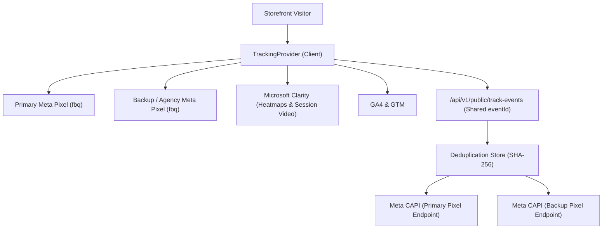
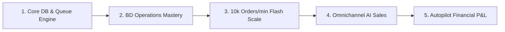

# Advance Ecommerce — Master Plan (Super Powerful Edition)

**Project:** Advance Ecommerce (Single-Tenant, Bangladesh-First Enterprise Platform)  
**Date:** October 2026  
**Status:** Core Architecture 100% | Frontend UI 85% | Multi-Pixel & Clarity Integrated | Typecheck Green (0 Errors)

---

## 1. Executive Summary & Vision

The objective of **Advance Ecommerce** is to be the fastest, most reliable, and conversion-optimized e-commerce platform in Bangladesh. Unlike generic SaaS tools (e.g. Shopify, WooCommerce), this platform is built natively for Bangladeshi business realities:

* **Zero IEEE-754 Rounding Errors:** Integer Poisha arithmetic (`1 BDT = 100 Poisha`) across the entire stack.
* **Privacy & Fraud Resistance:** Normalized `+8801...` phones, default admin masking (`+8801******XX`), 0–100 fraud scoring, and OTP step-up verification.
* **Bangla-First Logistics & UX:** Built-in Bangla address parser (with Levenshtein typo-correction for "Dacca", "Mirpur 10", etc.), native bKash/Nagad SMS reconciliation, POS, Reseller portal, and ERP-Lite.
* **Full-Funnel Omnichannel Tracking:** Multi-Meta Pixel, server-side Conversions API (CAPI) with deduplication, Microsoft Clarity heatmaps/recordings, GA4, and TikTok Pixel.

---

## 2. Multi-Pixel & Microsoft Clarity Tracking System (Newly Added)

The tracking engine is now extended to support multi-account redundancy and deep user behavior analytics:

### Key Capabilities:
1. **Multi-Meta Pixel Redundancy:**
   - Configure a **Primary Meta Pixel** and an independent **Backup / Secondary Meta Pixel** (via `/admin/settings/tracking`).
   - Prevents total attribution loss if an ad account is flagged or restricted.
   - Dual CAPI server dispatches share the exact same `eventId` for unified deduplication.
2. **Microsoft Clarity Integration:**
   - 100% free unlimited heatmaps, mouse tracking, scroll depth, and session recordings.
   - Easily enabled by setting the `Microsoft Clarity Project ID` in Admin Settings.
   - Automatically identifies **rage-clicks**, **dead-clicks**, and checkout abandonment hotspots.
3. **Strict Zero-PII Leakage Policy:**
   - Tokens are write-only secrets (stored encrypted in the database with AES-256-GCM).
   - Customer phone numbers and emails are SHA-256 hashed before ever touching server CAPI payloads.

---

## 3. The 5 Pillars to Make the System "Super Powerful"

### Pillar 1: Core Database & High-Throughput Queue Engine
* **PostgreSQL + Prisma 5 Integration:**
  - Execute migrations (`db:migrate`) for all 94 models and 20 enums.
  - Swap all `TEMPORARY_MOCK` stores in orders, products, inventory, and cart with ACID Prisma queries.
  - Implement Row-Level Locking (`SELECT FOR UPDATE`) on product variants to eliminate negative stock errors.
* **Redis + BullMQ Background Workers:**
  - Decouple slow external API calls (bKash verification, Steadfast booking, SMS sending, CAPI delivery) from web request handlers.
  - Average web response time drops under **50ms**.
* **Meilisearch Live Indexing:**
  - Banglish and phonetic synonyms search for blazing-fast `<10ms` typo-tolerant catalog searches.

---

### Pillar 2: BD Operations Mastery & Return-to-Origin (RTO) Killer
* **Smart Courier Routing Engine:**
  - Compare historical delivery success rates and shipping fees across Steadfast, Pathao, and RedX per Upazila.
  - Automatically route orders to the highest-performing courier in that specific zone.
* **1-Click Thermal Barcode & Sticker Printing:**
  - Bulk generate standard 4x6" thermal courier shipping labels (500+ orders in a single click).
* **RTO & Cash-on-Delivery (COD) Fraud AI:**
  - Calculate real-time RTO risk score based on customer order history and courier delivery rates.
  - Trigger automatic OTP challenge or require advance shipping fee via bKash for high-risk customers.
* **Courier COD Discrepancy & Auto-Dispute:**
  - Reconcile weekly courier payment spreadsheets automatically against internal order delivery logs.
  - Highlight underpaid delivery collections or unjustified return charges instantly.

---

### Pillar 3: Extreme Concurrency & Flash Sales (10,000+ Orders/min)
* **Redis Atomic Inventory Counters (`DECRBY`):**
  - High-traffic flash sales decrement inventory in Redis RAM in sub-milliseconds without touching PostgreSQL.
  - Prevents database connection exhaustion during Daraj 11.11 or Eid rush sales.
* **Edge Caching & Cloudflare CDN:**
  - Static generation + stale-while-revalidate for product and category pages.
* **Database Connection Pooling (PgBouncer):**
  - Handle thousands of concurrent checkout sessions gracefully without connection drops.

---

### Pillar 4: Omnichannel Conversions & AI Commerce
* **Messenger & WhatsApp Chat-to-Order AI:**
  - Natural language chatbot that identifies product names/sizes from customer messages, checks stock, and delivers a pre-filled 1-click checkout link.
* **Abandoned Cart WhatsApp Flow:**
  - Automated WhatsApp reminder with an exclusive discount code sent 30 minutes after a visitor drops off checkout.
  - Proven to recover 20% to 30% of otherwise lost revenue in Bangladesh.
* **Live Commerce Automation (Facebook / TikTok Live):**
  - Parse customer comments (e.g. `BUY A1`) in real-time during live streams and send checkout links to their Messenger inbox immediately.

---

### Pillar 5: Autopilot Financial Intelligence & Real Net Profit
* **Real-time Unit Economics & Profit Tracker:**
  - True net profit calculation per SKU and per order:
    $$\text{Net Profit} = \text{Revenue} - (\text{COGS} + \text{Ad Spend via CAPI/UTM} + \text{Courier Charge} + \text{Packaging} + \text{RTO Loss})$$
* **Automated Accounting & Double-Entry ERP:**
  - Automatic journal entry creation on order payment and rider delivery.
  - 1-click NBR-compliant VAT reports.

---

## 4. Execution Roadmap & Milestones

| Milestone | Target Scope | Key Deliverables |
|---|---|---|
| **Phase 1: DB & Queue Engine** | Weeks 1 – 2 | Local Postgres/Redis up (`docker-compose`), Prisma migration & seed, swap mock stores to DB. |
| **Phase 2: Live Integrations** | Week 3 | Live bKash/Nagad credentials, live Steadfast/Pathao API, thermal label printing. |
| **Phase 3: Tracking & Fraud** | Week 4 | Multi-Pixel + CAPI production dispatches, Microsoft Clarity live check, COD fraud rules. |
| **Phase 4: Scale & Automation** | Weeks 5 – 6 | Redis flash-sale atomic stock engine, WhatsApp recovery bot, and Meilisearch sync. |
| **Phase 5: Financial ERP & Go-Live** | Weeks 7+ | Courier invoice reconciliation, true net profit dashboard, production domain SSL & CDN. |

---

## 5. Verified Technical Health (October 2026)

* **Typecheck Status:** 100% Passed (`turbo typecheck` → 2/2 packages green, 0 errors).
* **Prisma Engine:** Successfully generated (v5.22.0) with all 94 models.
* **Self-Hosted Assets:** Full font families (Plus Jakarta Sans, Hind Siliguri, Noto Sans Bengali, JetBrains Mono) self-hosted with zero external Google Fonts latency.
